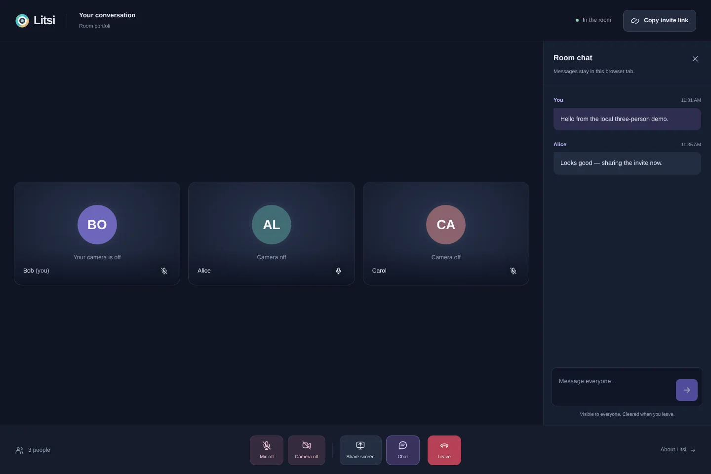

# Litsi

Small, account-free video calls. Create a room, check your camera and microphone, and share a link.

[Try the prototype](https://litsi.fly.dev/) · [Documentation](https://litsi.nirjan.dev/) · [Self-hosting guide](docs-site/self-hosting.md) · [Architecture](docs-site/architecture.md)



## What it does

- Create and join rooms without an account.
- Preview devices before joining; camera and microphone start off. Joining with both off is supported.
- Small-group WebRTC calls, screen sharing, and room chat.
- Responsive call controls with explicit device, connection, and permission states.
- Self-host the application as one Node process, with optional analytics disabled by default.

This is a deliberately bounded realtime-networking prototype, not a managed conferencing service. It has no recording, verified identities, moderation roles, automatic reconnect, or multi-instance coordination.

## Run locally

Use Node.js 22 and pnpm 9.11.0:

```sh
pnpm install --frozen-lockfile
cp .env.example .env
```

Set `NUXT_TURN_ID` and `NUXT_TURN_TOKEN` using [Cloudflare TURN credentials](https://developers.cloudflare.com/realtime/turn/generate-credentials/), then start:

```sh
pnpm dev
```

Open `http://localhost:3000`. Device permissions require a secure context: localhost works, but an HTTP LAN IP does not. Use HTTPS for remote access.

You can explore the entry/preview screens without TURN configuration, but peer setup needs the ICE endpoint. It returns 503 when TURN is unconfigured; direct networking is not a guaranteed no-credentials mode. The current provider integration is Cloudflare-specific.

`NUXT_PUBLIC_TELEMETRYDECK_APP_ID` is optional. Leave it empty to send no analytics. If configured, Litsi sends app/call usage event names without display names, room IDs, or chat payloads. `NUXT_PUBLIC_DOCS_URL` changes the app's documentation links.

## Self-host

The recommended public setup builds this repository and runs one application container behind Caddy HTTPS. TURN secrets are provided at runtime, never as image build arguments.

```sh
mkdir -p "$HOME/.config/litsi"
cp deploy/.env.example "$HOME/.config/litsi/deploy.env"
# Edit that file: set LITSI_DOMAIN, NUXT_TURN_ID, and NUXT_TURN_TOKEN.
docker compose --env-file "$HOME/.config/litsi/deploy.env" \
  -f deploy/compose.yaml up -d --build
```

Point your domain at the host and allow ports 80/443 before starting. The Node port is not published. Caddy handles TLS and WebSocket upgrades. See the [full guide](docs-site/self-hosting.md) for prerequisites, upgrades, Fly.io, and documentation publication.

For a direct Node deployment behind an HTTPS reverse proxy:

```sh
pnpm build
HOST=127.0.0.1 PORT=3000 node --env-file=.env .output/server/index.mjs
```

The application needs a long-lived Node server. `pnpm generate`, static hosting, serverless adapters, clustered workers, and multiple replicas do not preserve its in-memory room model. The documentation site is static; the call app is not.

## Networking and trust boundaries

- **Signalling and chat:** browsers connect to the same origin's `/_ws` route. The server holds membership and forwards negotiation messages and chat. Display names must be unique within a live room; duplicate admissions are rejected rather than replacing someone.
- **Media:** simple-peer establishes a WebRTC mesh. Camera, microphone, and screen media travel directly between browsers or through Cloudflare TURN when a relay is needed, not through the Nuxt server.
- **Access:** possession of a room link permits joining. Names are unverified; there is no account, password, or host approval system. Share invitations privately.
- **Storage:** the app persists no media or chat history. Rooms, admission capabilities, and credential caches live in memory; chat lives in browser tabs. Hosting/proxy logs and third-party processing are separate boundaries, not a “nothing is stored anywhere” promise.
- **Restart:** deploying/restarting clears live room state and disconnects clients. There is no automatic room recovery.

### TURN admission and budgets

An admitted WebSocket receives an opaque one-hour capability. `POST /api/getIceUrls` requires its bearer token and JSON `{ "roomID": "…" }`. A disconnect revokes that capability.

Each browser session reuses/coalesces its credentials across peers until 60 seconds before their expiry. Limits are 12 endpoint requests per minute per session, a 30-second provider-attempt cooldown per session, and 60 provider attempts per hour for the whole process. Responses are `no-store`; credentials request a one-hour TTL. These controls bound issuance, not all possible abuse or provider cost.

Run **exactly one Node process and one machine**. For Fly, run `fly scale count 1`; the workflow does not manage scaling. `fly.toml` disables autostop. Sessions do not renew automatically; after one hour, rejoin before connecting new participants. Longer calls are outside the supported prototype envelope.

Read [privacy and limits](docs-site/privacy-and-limits.md) and [troubleshooting](docs-site/troubleshooting.md) before operating a public instance.

## Verification

```sh
pnpm test        # Production build, then Node regression scenarios
pnpm test:built  # Reuse an existing production build
```

The black-box scenarios run the real Nitro server with a loopback synthetic TURN provider. They cover capability protection and budgets, duplicate-name admission, room isolation, membership/media-state transitions, and transport closure/readmission. Pure peer-registry scenarios cover signals arriving before ICE setup and stale asynchronous peers. They do not contact Cloudflare or prove cross-network TURN connectivity.

For an isolated manual browser check after building:

```sh
node test/fixture.mjs
```

Open the printed loopback URL. The fixture uses synthetic ICE responses; it is not a real TURN relay. Use distinct display names and generated media, not private calls. The docs screenshots use synthetic names/messages with cameras off. Local browser verification also exercised two- and three-peer media, receive-only joining, adding devices during a call, screen sharing/teardown, chat, denied permissions, and leave/readmission. This is local proof, not a production scale or cross-network reliability claim.

## Documentation development

The VitePress site is independent of the app and its secrets:

```sh
cd docs-site
pnpm install --frozen-lockfile
pnpm dev
pnpm build
```

`.github/workflows/docs.yml` publishes it through GitHub Pages on `master` at [litsi.nirjan.dev](https://litsi.nirjan.dev/); **GitHub Actions** is the Pages source and the custom domain is configured in the repository's Pages settings. The build defaults to a root base for that domain; set the `DOCS_BASE` repository Actions variable to `/litsi/` only for the `nirjan-dev.github.io/litsi/` project site. Documentation-only changes do not redeploy the Fly app. See [publication instructions](docs-site/self-hosting.md#publish-the-documentation).

## Project layout

- `pages/` — landing, pre-call setup, and conversation UI.
- `composables/useCallMedia.ts` — local device acquisition and cleanup.
- `composables/useRoomCall.js`, `utils/peerRegistry.mjs` — client negotiation and peer lifecycle.
- `server/routes/_ws.ts` — room admission, membership, signalling, chat, and media state.
- `server/utils/turnSessions.ts`, `server/api/getIceUrls.ts` — capability-bound TURN issuance.
- `test/` — isolated runtime fixtures and regression checks.
- `deploy/` — single-instance Compose/Caddy deployment.
- `docs-site/` — static project and operator documentation.

## Licence and credits

[MIT](LICENSE) · [Nirjan Khadka](https://nirjan.dev/)

Built with [Nuxt](https://nuxt.com/), [Vue](https://vuejs.org/), [Nuxt UI](https://ui.nuxt.com/), and [simple-peer](https://github.com/feross/simple-peer). TURN connectivity uses [Cloudflare Realtime TURN](https://developers.cloudflare.com/realtime/turn/). The entry flow takes inspiration from [Orange Meets](https://demo.orange.cloudflare.dev/); Litsi retains its own interface and peer-to-peer mesh implementation.
